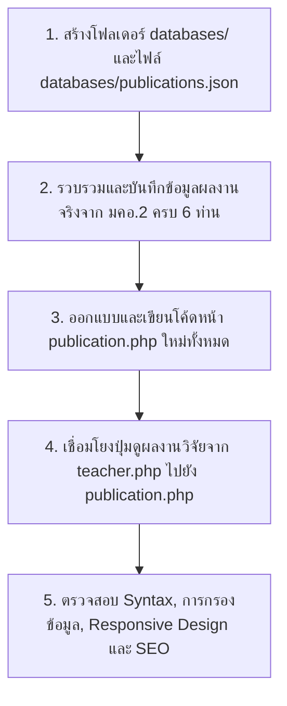

# แผนงานปรับปรุงระบบผลงานตีพิมพ์ทางวิชาการ (Academic Publications Revamp Plan)
**หลักสูตรวิทยาการคอมพิวเตอร์ คณะวิทยาศาสตร์และเทคโนโลยี มหาวิทยาลัยราชภัฏวไลยอลงกรณ์ ในพระบรมราชูปถัมภ์**

เอกสารฉบับนี้กำหนดแผนงานและข้อกำหนดทางเทคนิคสำหรับการยกเครื่องหน้าผลงานตีพิมพ์ทางวิชาการ ([`publication.php`](publication.php)) โดยเปลี่ยนจากการพึ่งพา External API ภายนอกและหลีกเลี่ยงความซับซ้อนของ Database Server มาใช้ระบบ **Flat-file Database ในโฟลเดอร์ `databases/`** ซึ่งปลอดภัย รวดเร็ว เสถียร และรองรับ SEO เต็มรูปแบบ

---

## 📌 1. ที่มาและความจำเป็น (Background & Motivation)

จากการวิเคราะห์ระบบเดิมในหน้า [`publication.php`](publication.php) พบจุดที่ต้องได้รับการปรับปรุงเร่งด่วน:
1. **ความเสถียร (Reliability)**: ดึงข้อมูลจาก External API (`https://www.ckartisan.com/api/publication`) ซึ่งหากเซิร์ฟเวอร์ภายนอกล่มหรือมีการเปลี่ยนแปลง URL เว็บไซต์หลักสูตรจะไม่สามารถแสดงผลงานวิจัยได้
2. **ความปลอดภัย (Security)**: มีปุ่มและโมดอล "สร้าง Publication ใหม่" เปิดสาธารณะให้บุคคลภายนอกส่งข้อมูลเข้าสู่ระบบโดยไม่มีการยืนยันตัวตน (Authentication) เสี่ยงต่อ Spam และข้อมูลปลอมแปลง
3. **ความน่าเชื่อถือทางวิชาการ (Academic Credibility)**: ผลงานวิจัยจริงย้อนหลัง 5 ปี (พ.ศ. 2563–2568) ของคณาจารย์ทั้ง 6 ท่านที่ปรากฏในเอกสารหลักสูตร มคอ.2 ยังไม่ได้ถูกนำมาจัดแสดงบนเว็บไซต์
4. **ภาพประกอบไม่ตรงเนื้อหา**: แสดงภาพระบบสอบออนไลน์ (`images/online-exmaination-system.png`) ซึ่งไม่เกี่ยวข้องกับผลงานวิจัยของหลักสูตร

---

## 📂 2. สถาปัตยกรรมการจัดเก็บข้อมูล (Architecture & Storage)

เลือกใช้แนวทาง **Local Flat-file Database** ภายในโฟลเดอร์ `databases/`:

```
d:/php-vanila/cs/
├── databases/
│   ├── .gitkeep                                      <-- บังคับสร้างโฟลเดอร์บน Git
│   ├── publications.json                             <-- ฐานข้อมูลจริง (Active DB - Git Ignore)
│   ├── publications-backup-YYYYMMDD.json             <-- ไฟล์สำรองข้อมูลที่จัดระเบียบแล้ว (อนุญาตให้ขึ้น Git)
│   └── publications-backup-original-YYYYMMDD.json    <-- ไฟล์สำรองข้อมูลดิบต้นฉบับตรงจาก API 100% (อนุญาตให้ขึ้น Git)
├── publication.php                                   <-- หน้าแสดงผลผลงานวิจัย (SSR + Instant Filter)
├── teacher.php                                       <-- หน้าอาจารย์ (เชื่อมโยงมายังผลงานวิจัย)
└── PUBLICATIONS-PLAN.md                              <-- เอกสารแผนงานฉบับนี้
```

### การควบคุมเวอร์ชันด้วย Git (.gitignore):
```gitignore
databases/*
!databases/.gitkeep
!databases/publications-backup-*.json
!databases/publications.backup.json
```
* **ไฟล์ฐานข้อมูลจริง (`publications.json`)**: จะถูก `.gitignore` ไม่ให้ขึ้น Git เพื่อป้องกันข้อมูล Production/Local ถูกเขียนทับ
* **ไฟล์สำรอง (`publications-backup-*.json`)**: จะถูกอนุญาตให้ขึ้น Git เสมอ มี timestamp กำกับชัดเจน รองรับการเก็บประวัติและสามารถนำไป Restore หรือ Deploy บนเครื่องใหม่ได้ทันที


### ทำไมโฟลเดอร์ `databases/` จึงเหมาะสม?
* **แยกเป็นสัดส่วนชัดเจน**: แยกข้อมูล (Data Layer) ออกจากโค้ดของระบบและโครงสร้างหน้าตา (View Layer)
* **ไม่ต้องติดตั้ง/ตั้งค่า Database Server**: ไม่ต้องมี MySQL/PostgreSQL ลดภาระการดูแลระบบ ไม่ต้องกังวลเรื่อง SQL Injection หรือ Database Connection Timeout
* **ประสิทธิภาพสูงมาก (High Performance)**: ข้อมูลผลงานวิจัยของหลักสูตร (ประมาณ 20–100 รายการ) อ่านผ่าน PHP `file_get_contents()` ใช้เวลาไม่ถึง 1 มิลลิวินาที
* **สำรองและกู้คืนง่าย (Version Control Friendly)**: ข้อมูลทั้งหมดอยู่ใน Git Repository สามารถติดตามประวัติการแก้ไขและย้อนกลับได้ทันที

---

## 📋 3. โครงสร้างข้อมูล (Data Schema: `databases/publications.json`)

ออกแบบฟิลด์ข้อมูลให้รองรับทั้งการจัดแสดงแบบตาราง (Table View), รายการอ้างอิงมาตรฐานวิชาการ (APA 7th Edition), และการกรองข้อมูล (Facet Filtering):

```json
[
  {
    "id": "PUB-2568-01",
    "year_th": 2568,
    "year_en": 2025,
    "title": "การจำแนกความรุนแรงของอุบัติเหตุทางถนนในประเทศไทยด้วยเทคนิคการจัดกลุ่มแบบเคมีนส์ และต้นไม้ตัดสินใจ",
    "authors": ["ประณมกร อัมพรพรรดิ์"],
    "teacher_ids": ["pranomkorn"],
    "type": "journal",
    "language": "th",
    "tier": "TCI 2",
    "category": "วารสารระดับชาติ",
    "journal_name": "วารสารเทคโนโลยีสารสนเทศและนวัตกรรม",
    "volume": "24",
    "issue": "2",
    "month_range": "กรกฎาคม – ธันวาคม",
    "pages": "76-89",
    "conference_name": null,
    "location": null,
    "publisher": null,
    "url": "",
    "doi": "",
    "abstract": ""
  }
]
```

### คำอธิบายฟิลด์สำคัญ:
| ฟิลด์ | ชนิดข้อมูล | คำอธิบาย | ตัวอย่าง |
| :--- | :--- | :--- | :--- |
| `id` | String | รหัสผลงานวิจัยเฉพาะ (Primary Key) | `"PUB-2567-01"` |
| `year_th` / `year_en` | Number | ปี พ.ศ. และ ค.ศ. ที่ตีพิมพ์ | `2567`, `2024` |
| `title` | String | ชื่อบทความวิชาการ / งานวิจัย | `"การพัฒนากิจกรรมการโค้ช..."` |
| `authors` | Array | รายนามผู้ประพันธ์ทุกคน | `["ณัฏฐิรา ศุขไพบูลย์", "เทิดทูน ไทศรีวิชัย"]` |
| `teacher_ids` | Array | รหัสอาจารย์ในหลักสูตร (อิงตาม `json/teacher.json`) | `["nattira"]` |
| `type` | String | ประเภทผลงาน: `journal` (วารสาร), `conference` (ประชุมวิชาการ), `book` (ตำรา) | `"journal"` |
| `tier` | String | ระดับคุณภาพ: `Scopus Q1-Q4`, `TCI 1`, `TCI 2`, `กพอ.` | `"TCI 1"` |
| `category` | String | หมวดหมู่: `วารสารนานาชาติ`, `วารสารระดับชาติ`, `การประชุมวิชาการ` | `"วารสารระดับชาติ"` |
| `source_citation` | String | ข้อความอ้างอิงสมบูรณ์ตามหลัก APA 7th | Auto-generated หรือระบุไว้ |

---

## 🎨 4. การออกแบบหน้าเว็บใหม่ ([`publication.php`](publication.php))

### 4.1 ส่วนหัวและสถิติภาพรวม (Hero & Research Impact Dashboard)
* แบนเนอร์หัวข้อ **"ผลงานตีพิมพ์และงานวิจัย (Research & Publications)"** สไตล์ Academic สวยงาม สะอาดตา
* การ์ดสถิติสรุปภาพรวม (Metric Cards):
  * 📊 **ผลงานวิจัยทั้งหมด (Total Publications)**
  * 🌐 **ระดับนานาชาติ / Scopus**
  * 🇹🇭 **วารสารระดับชาติ (TCI กลุ่ม 1 และ 2)**
  * 👥 **จำนวนคณาจารย์ที่มีผลงานตีพิมพ์**

### 4.2 ระบบค้นหาและตัวกรองอัจฉริยะ (Interactive Search & Filters)
* **Instant Keyword Search**: พิมพ์ค้นหาชื่อบทความ, คำสำคัญ, หรือชื่อผู้แต่งได้ทันที
* **Filter by Faculty Member**: กรองดูเฉพาะผลงานของอาจารย์แต่ละท่าน (เชื่อมโยงจากหน้าอาจารย์ [`teacher.php`](teacher.php) ได้โดยตรงผ่าน query string เช่น `publication.php?author=witsarut`)
* **Filter by Year**: กรองตามปี พ.ศ. (2569, 2568, 2567, 2566, 2565, 2564, 2563)
* **Filter by Tier / Type**: กรองตามระดับคุณภาพ (Scopus, TCI 1, TCI 2, กพอ., ประชุมวิชาการ)

### 4.3 รูปแบบการจัดแสดง 2 มุมมอง (Dual View Modes)
1. **มุมมองรายการอ้างอิงวิชาการ (APA 7th Academic Citation View - Default)**:
   - จัดแสดงรายการผลงานตามมาตรฐาน APA 7th พร้อมป้าย Badge ระบุปี, ระดับ TCI/Scopus และปุ่มดาวน์โหลดเอกสาร/DOI
   - แบ่งหมวดหมู่ตามปี พ.ศ. ชัดเจน
2. **มุมมองตารางข้อมูล (Data Table View)**:
   - แสดงผลในรูปแบบตารางค้นหา พร้อมปุ่ม Sort และ Pagination ด้วย DataTables / Vanilla Table

### 4.4 ความปลอดภัยและความสมบูรณ์
* ❌ นำปุ่มและโมดอล "สร้าง Publication ใหม่" ออก ป้องกันการป้อนข้อมูลโดยไม่ได้รับอนุญาต
* ❌ นำ JavaScript เดิมที่ดึงข้อมูลจาก `ckartisan.com` ออกทั้งหมด
* ❌ นำภาพสอบออนไลน์ที่ไม่เกี่ยวข้องออก

---

## 🗄️ 5. แหล่งข้อมูลจริงที่ใช้บรรจุในระบบ (Real Data from MKO2)

ข้อมูลผลงานวิจัย 5 ปีล่าสุดของอาจารย์ทั้ง 6 ท่านที่รวบรวมจาก [`mka2-70/extracted_content/09_faculty_publications_research.md`](mka2-70/extracted_content/09_faculty_publications_research.md):

1. **ผศ.ณัฏฐิรา ศุขไพบูลย์** (`nattira`):
   - วารสารนวัตกรรมการเรียนรู้และเทคโนโลยี (2567) - TCI 2
   - วารสารวิชาการเทคโนโลยีอุตสาหกรรม มรภ.สวนสุนันทา (2567) - TCI 2
   - วารสารวิจัยและนวัตกรรมทางวิทยาศาสตร์และเทคโนโลยี (2567) - เกณฑ์ กพอ.
2. **ดร.ประณมกร อัมพรพรรดิ์** (`pranomkorn`):
   - วารสารเทคโนโลยีสารสนเทศและนวัตกรรม (2568/2025) - TCI 2
   - Advanced Science Journal (2565/2022) - TCI 2
   - Asian Interdisciplinary and Sustainability Review (2564/2021) - TCI 1
   - ตำรา: คณิตศาสตร์ดิสครีตสำหรับวิทยาการคอมพิวเตอร์ (2567)
3. **ดร.ดาวรถา วีระพันธ์** (`daoratha`):
   - วารสารวิทยาศาสตร์ วิศวกรรมศาสตร์ และเทคโนโลยี มรภ.เลย (2569) - TCI 2
   - วารสารวิจัยและนวัตกรรมทางศึกษา (2568) - TCI 2
   - วารสารมหาวิทยาลัยราชภัฏร้อยเอ็ด (2568) - TCI 2
   - วารสารการพัฒนาชุมชนและคุณภาพชีวิต (2568) - TCI 2
   - วารสารวิทยาศาสตร์และเทคโนโลยี มรภ.ศรีสะเกษ (2568) - TCI 1
   - วารสารวิทยาศาสตร์และเทคโนโลยีแห่งรัตนโกสินทร์ (2567) - TCI 2
   - วารสารบัณฑิตศึกษามหาวิทยาลัยราชภัฏวไลยอลงกรณ์ฯ (2567) - TCI 1
   - วารสารวิจัยและพัฒนามหาวิทยาลัยราชภัฏสวนสุนันทา (2566) - TCI 2
4. **ผศ.ดร.วิศรุต ขวัญคุ้ม** (`witsarut`):
   - CURRENT APPLIED SCIENCE AND TECHNOLOGY (2566/2023) - Scopus Q4
   - วารสารวิจัยและนวัตกรรมทางวิทยาศาสตร์และเทคโนโลยี (2568) - เกณฑ์ กพอ.
   - วารสารวิทยาศาสตร์และเทคโนโลยีแห่งรัตนโกสินทร์ (2567) - TCI 2
   - วารสารวิจัยและนวัตกรรมทางวิทยาศาสตร์และเทคโนโลยี (2567) - เกณฑ์ กพอ.
   - วารสารวิจัยและนวัตกรรมทางวิทยาศาสตร์และเทคโนโลยี (2564) - เกณฑ์ กพอ.
   - ตำรา: เอกสารประกอบการสอนรายวิชาการทำเหมืองข้อมูล (2565)
5. **อ.ณัฐรดี อนุพงค์** (`natradee`):
   - วารสารวิทยาศาสตร์ วิศวกรรมศาสตร์ และเทคโนโลยี มรภ.เลย (2569) - TCI 2
   - วารสารวิทยาศาสตร์และเทคโนโลยี มรภ.ศรีสะเกษ (2568) - TCI 1
   - วารสารวิจัยและนวัตกรรมทางศึกษา (2568) - TCI 2
   - วารสารมหาวิทยาลัยราชภัฏร้อยเอ็ด (2568) - TCI 2
   - วารสารวิจัยและนวัตกรรมทางวิทยาศาสตร์และเทคโนโลยี (2568) - เกณฑ์ กพอ.
   - วารสารวิทยาศาสตร์และเทคโนโลยีแห่งรัตนโกสินทร์ (2567) - TCI 2
   - วารสารวิจัยและพัฒนามหาวิทยาลัยราชภัฏสวนสุนันทา (2566) - TCI 2
6. **อ.ชวลิต โควีระวงศ์** (`chawalit`):
   - วารสารวิทยาศาสตร์และเทคโนโลยีแห่งรัตนโกสินทร์ (2567) - TCI 2
   - วารสารวิจัยและนวัตกรรมทางวิทยาศาสตร์และเทคโนโลยี (2565) - เกณฑ์ กพอ.

---

## 🚀 6. แผนการดำเนินงานและขั้นตอนปฏิบัติ (Implementation Steps)



### รายละเอียดงานย่อย:
- [x] **ขั้นตอนที่ 1**: สร้างโฟลเดอร์ `databases/` พร้อมการตั้งค่า `.gitignore` และ `.gitkeep`
- [x] **ขั้นตอนที่ 2**: สร้างและลงข้อมูลใน `databases/publications.json` พร้อมไฟล์สำรอง (`publications-backup-*.json`, `publications-backup-original-*.json`, `publications-backup-edit-*.json`)
- [x] **ขั้นตอนที่ 3**: ปรับปรุงหน้า [`publication.php`](publication.php):
  - [x] โหลดข้อมูลจาก `databases/publications.json` ผ่าน PHP (Fast SSR)
  - [x] ทำระบบค้นหาและตัวกรอง (Filter) ตามชื่ออาจารย์, ปี พ.ศ., และประเภทผลงาน
  - [x] รองรับการสลับดู 2 มุมมอง: รายการบรรณานุกรมต่อเนื่อง (Continuous Bibliography List) และ ตารางข้อมูล (DataTable)
  - [x] รองรับการสลับ Re-render รูปแบบการอ้างอิงทันทีด้วย JavaScript (APA 6th Thai มคอ.2, APA 7th, IEEE, Vancouver)
  - [x] เรียงลำดับจากปีล่าสุดลงมา (Descending by year)
  - [x] ปรับให้คัดลอก (Copy) ไปใช้งานได้ง่าย ไม่มี badge/label รกสายตา
  - [x] นำ Modal และ External API เดิมออกอย่างปลอดภัย
- [x] **ขั้นตอนที่ 4**: เชื่อมโยงปุ่ม "ดูผลงานวิจัย" ในหน้า [`teacher.php`](teacher.php) ให้ส่ง Query String `publication.php?author=...` มาทำงานได้อย่างถูกต้อง
- [x] **ขั้นตอนที่ 5**: ตรวจสอบความถูกต้องด้วย `php -l publication.php` และตรวจสอบการแสดงผลบนอุปกรณ์เคลื่อนที่ เรียบร้อย 100%

